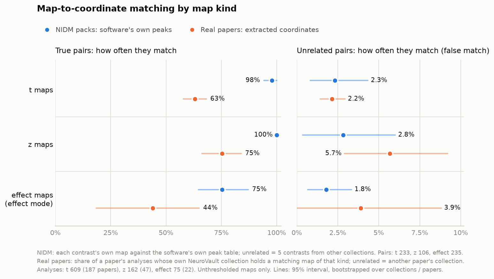

# Outreach map matching: calibration and benchmark

Calibrates `neurostore/outreach/matching.py` against real papers, the scorer behind
the SPAM upload form. Produced by `calibrate_outreach_matching.py` and
`calibrate_outreach_matching_nidm.py` (calibration), `benchmark_outreach_matching.py`
(timings) and `plot_outreach_matching.py` (the figure). Run on 2026-10-30, with the
NIDM packs and the figure added on 2026-11-02.

## Data

Every neurostore base study that has both a DOI-linked NeuroVault collection (a
study version with source `neurovault`) and a coordinate version with at least one
analysis of 3+ coordinates: 296 of the 677 base studies with images. 293 were
scored once downloads were done.

- **Maps:** 2,138 maps, sorted by kind using the file name before NeuroVault's map
  type. SPM's `beta_0001` and `con_0001` are often uploaded as "T map", and FSL's
  `cope2_zstat1` is a z map.
  - **statistic** (t, z, F): 1,744 maps, at most 12 per paper.
  - **effect** (`cope*`, `con_*`, `beta_*`, `effect_size`, `stat-effect`, or
    NeuroVault's "univariate-beta"): 185 maps, all of them.
  - **ambiguous** ("other" with no name hint): 246 maps.

  P maps, masks, parcellations and anatomicals were left out, as were maps that
  NeuroVault's February 2024 dump flags as single-subject or not MNI.
- **The rates below count only unthresholded maps,** since outreach asks for no
  other kind. That is 1,842 maps from 269 papers: those NeuroVault doesn't flag as
  thresholded and the module doesn't read as thresholded. `report --maps all` gives
  the full set.
- **Analyses:** 875 (median 2 per paper, 6 coordinates each), mostly from the
  `nuextract-v21` extraction, the source outreach drafts are built from.
- **Negatives:** each paper's maps were also scored against the analyses of 3
  randomly chosen other papers. That gives 6,628 own pairs and 15,794 cross pairs.

On real papers there is no ground truth for which map goes with which analysis
(the NIDM packs below supply it, with ideal coordinates). Collections usually hold
more maps than the paper tabled, so a map that matches nothing is not counted as a
failure. Three measures are used instead:

- **Per analysis:** does its own collection hold a map that matches it, against
  how often an unrelated paper's collection does. The second number is the
  false-match rate.
- **Name-matched pairs:** an analysis and a map whose names agree and are each
  other's best name match (103 pairs; "faces > houses" ↔ `faces_gt_houses`). These
  are very likely true pairs. Comparing which side each name puts first splits
  them into 89 that state the same direction and 14 that state the reverse (the
  table reports B > A, the collection holds A > B).
- **Suggested assignment:** how many analyses get a map from their own collection,
  against how many get one from an unrelated collection.

## What the calibration changed

The first version averaged each coordinate's percentile. At its threshold, an
unrelated collection matched 20% of analyses, and 33% of those with 3–4
coordinates. Two changes, chosen on this data, brought that down to 3%:

1. **A coordinate counts only on a local peak.** It must sit near a local peak of
   the map; one on a slope counts as chance (0.5). This was the strongest single
   feature (AUC 0.867 against 0.844 for the plain mean).
2. **Shrinkage toward chance.** Each reading is shrunk toward 0.5 by 3 phantom
   coordinates, so 3 lucky coordinates can't carry an analysis. This replaced an
   n-dependent z floor that did worse.

Maps also have to be read as thresholded or not. In an unthresholded map, 0 and
NaN mark the edge of the mask and count as missing; in a thresholded map they mean
below threshold. A non-zero share alone misread 39% of NeuroVault's unthresholded
maps. The rule used combines that share with a gap around zero: it catches 83% of
flagged-thresholded maps and misreads 1.5% of unthresholded ones.

## Results at the defaults, unthresholded maps

Defaults: `match=0.65`, `margin=0.1`, `flip_margin=0.2`, and `effect_match=0.7`
for maps scored as effect maps (see Effect maps).

| measure | rate |
|---|---|
| own collection holds a matching map, per analysis | 65.0% |
| an unrelated collection matches, per analysis (false match) | 3.1% |
| an unrelated collection gives a match or any flag | 5.8% |
| unrelated pair called `match` | 0.6% |
| name-matched, same direction: `match` | 78% |
| name-matched, same direction: warned (`reversed_sign` / `lr_flip`) | 3.4% |
| name-matched, same direction: `no_match` | 18% |
| name-matched, reversed direction: caught as `reversed_sign` | 79% |
| assignment gives an own analysis a map (one / two sides per map) | 64.8% / 70.7% |
| assignment gives an unrelated analysis a map (one / two sides per map) | 5.4% / 5.4% |
| `lr_flip` on own / unrelated pairs | 0.0% / 0.0% |
| maps `cannot_assess`, all 2,138 | 13 (10 SUIT or partial field of view, 3 masks) |

By coordinate count, the false-match rate per analysis is 4.7% at 3–4 coordinates,
3.0% at 5–8, 2.0% at 9–16 and 0.8% at 17+. The own-collection rate is 60–69%
throughout.

**The false-warning rate is about 3%.** A warning (reversed sign or left/right
flip) on a pair that is very likely true happens about 3% of the time. Nearly every
`reversed_sign` on a name-matched pair was a genuine reversal ("Hits > Misses"
against a map named "Misses > Hits").

**The miss rate is 18% at most.** That is the share of very likely true pairs that
come back `no_match`. It is an upper bound: some name-matched maps are a different
analysis (a seed map against a multi-seed table, an ROI result against a
whole-brain map).

## Ground truth: NIDM-Results packs

A NIDM-Results pack is one analysis exported by SPM, FSL or SnPM: its peak table
plus, for each contrast, the t or z map, the contrast (effect) map and its
standard error map. The peaks are the software's own, taken from that very t map.
So these are true pairs, and the statistic maps show the ceiling for perfectly
extracted coordinates. `calibrate_outreach_matching_nidm.py` builds the set.

- **Packs:** NeuroVault's dump lists 645 packs; 546 could be fetched.
- **Dropped:**
  - 232 single-subject packs;
  - 93 contrasts in subject or SUIT space;
  - 31 packs whose NeuroVault folder holds another upload's files of the same names;
  - 6 contrasts with fewer than 3 peaks.
- **Left:** 245 group contrasts in 42 collections, mostly SPM, with FSL and the 21
  pain studies NiMARE ships. Their maps: 234 t, 106 z, 9 F, 236 effect and
  236 standard error.
- **Negatives:** each contrast's maps against the peaks of 5 contrasts from other
  collections. Any whose peaks largely coincide with its own (the same open dataset
  exported twice) are skipped.

| map, scored against its own contrast's peaks | n | match | unrelated contrasts: match / any flag (n) |
|---|---|---|---|
| t | 234 | 97.9% | 2.3% / 4.0% (1,163) |
| z | 106 | 100% | 2.8% / 4.7% (529) |
| F | 9 | 100% | 2.3% / 4.5% (44) |
| effect, scored as a statistic map | 236 | 59.1% | 1.1% / 2.2% (1,173) |
| effect, scored as an effect map | 236 | 75.3% | 1.8% / 3.3% (1,173) |
| standard error | 236 | 0.4% | 0.0% / 0.7% (1,180) |

**With perfect peaks, statistic maps almost always match.** The 6 mm local-peak
test behind the false-match control costs real t maps about 2%. The gaps on real
papers (65% of analyses) come from the coordinates, the tables and which maps were
uploaded, not from the scorer.

**Effect maps lose a lot to the local-peak test.** Their strongest value near a
peak taken from the t map is itself a local peak 52% of the time, against 89% in
the t map. With 236 effect maps and 1,173 unrelated contrasts, effect-only scoring
variants could be compared properly here (6 mm unless noted):

| effect-map scoring | true pairs matched | unrelated matched |
|---|---|---|
| statistic rules (off-peak coordinates count as chance), 0.65 | 59.1% | 1.1% |
| same, threshold set for 2% false matches (0.62) | 70.6% | 2.0% |
| off-peak coordinates count half, 0.65 | 88.5% | 4.6% |
| off-peak coordinates count half, 0.68 | 84.7% | 2.2% |
| **off-peak coordinates count half, 0.70 (adopted)** | **75.3%** | **1.8%** |
| off-peak coordinates count half, 0.72 | 69.8% | 1.4% |
| 8 mm, statistic rules, 0.65 | 69.1% | 1.7% |
| 10 mm, statistic rules, 0.65 | 71.2% | 3.1% |
| no local-peak test, 0.65 | 94.9% | 16.4% |

For t maps the statistic rules stay best: half credit at 0.70 gives 97.4% / 2.8%,
against 97.9% / 2.3% now.

**Adopted: an opt-in effect-map mode.** `score_map(..., kind="effect")`, or
`match_maps(..., kinds={id: "effect"})`, gives off-peak coordinates half credit and
requires 0.70. Statistic maps are scored exactly as before; that is the default
`kind`.

**Within a collection, effect maps are also less specific.** This test assigns one
kind of map at a time against all of its collection's contrasts:

| maps | own contrast | a re-export of the same data | another contrast, negative side | another contrast (wrong) |
|---|---|---|---|---|
| t | 82.9% | 12.0% | 0.0% | 2.6% |
| z | 84.9% | 13.2% | 20.8% | 1.9% |
| effect (effect mode) | 58.5% | 12.7% | 1.7% | 8.9% |
| standard error | 5.9% | 0.8% | 3.0% | 1.3% |

The z maps' negative-side share is correct behaviour. Several FSL packs hold both
A > B and B > A, and both are read off one z map. **Standard error and variance
maps match nothing, so don't score them.**

## Effect maps on real papers

SPAM asks for each contrast's effect map (FSL cope, SPM con, nilearn
`effect_size`, FitLins `stat-effect`, NeuroVault "univariate-beta") alongside its
t or z map. **The real-paper effect-map sample is small.** All of NeuroVault
(February 2024) has unthresholded effect maps in only 55 DOI-linked collections.
22 of those are here, with usable coordinates. The other 33 have no analysis with
3+ coordinates, or their "effect" files are P maps, anatomicals, or OpenfMRI
re-analyses rather than the paper's maps. Only 11 papers hold both an effect and a
statistic map, so each analysis is about 2 points in the 11-paper rows. The NIDM
packs above carry the weight; these rows check that the effect mode also helps
with extracted coordinates.

| kind | papers | maps | analyses | own coll. match | unrelated coll. match (n) | assigned own | assigned unrelated |
|---|---|---|---|---|---|---|---|
| statistic | 242 | 1,495 | 784 | 66.8% | 2.8% (2,042) | 71.3% | 5.1% |
| effect, statistic rules | 22 | 185 | 75 | 40.0% | 6.1% (179) | 38.7% | 7.3% |
| effect, effect mode | 22 | 185 | 75 | 44.0% | 3.9% (179) | 38.7% | 5.6% |
| ambiguous | 30 | 162 | 94 | 28.7% | 2.5% (285) | 38.3% | 3.5% |
| statistic, the 11 papers with both | 11 | 63 | 51 | 58.8% | 0.0% (93) | 45.1% | 2.2% |
| effect, the 11 papers with both, statistic rules | 11 | 89 | 51 | 49.0% | 8.8% (91) | 43.1% | 9.9% |
| effect, the 11 papers with both, effect mode | 11 | 89 | 51 | 56.9% | 3.3% (91) | 49.0% | 5.5% |

**Same analysis, effect map against its own statistic map.** This uses 50
effect/statistic pairs the program can trust: a name match the maps agree with
(r ≥ 0.8), or a correlation 0.1 clear of every other candidate. That gives 188
(pair, analysis) comparisons:

| scoring | statistic matches, effect too | statistic matches, effect doesn't | effect matches, statistic doesn't |
|---|---|---|---|
| statistic rules | 15 | 19 | 5 |
| effect mode | 21 | 13 | 5 |

Where the statistic map matches, its effect map matches 62% of the time in effect
mode (44% under statistic rules). With statistic rules the gap was significant
(19 against 5 discordant, McNemar p ≈ 0.007).

**Recommendation: match each contrast set by its statistic map.** Carry that
assignment to the set's effect and variance maps. On real papers the statistic
map is both more sensitive and more specific.
- **Effect map alone:** score it with `kind="effect"` only when it is all the
  author has. With perfect coordinates expect about 75% matches; with extracted
  ones about 45–55%. False matches run about 2–4%.
- **Variance and standard error maps:** never score them against coordinates.
- **Effect and variance but no statistic map:** z ≈ effect / √variance at the
  sampled voxels would turn the pair into a statistic map. That isn't built; it is
  worth doing if such uploads turn out to be common.

### Pairing effect maps with statistic maps

The form groups files into effect / statistic / variance sets per contrast.

**By name.** The rules strip the words that say what kind of map a file is, so
`cope3` ↔ `zstat3`, `con_0003` ↔ `spmT_0003`, `X_effect_size` ↔ `X_z_score` and
`stat-effect` ↔ `stat-t` agree.
- **Coverage:** a unique partner exists for 48 of the 89 effect maps that sit in a
  collection with statistic maps (47 by file name, 1 by map title).
- **Accuracy:** 9 of those 48 are wrong (r < 0.5), and they come from two places.
  SPM numbers betas and contrasts separately, so `beta_0003` is not `spmT_0003`'s
  effect. Collections that merge several SPM folders also reuse `con_0001`.
  The right name pairs correlate strongly (median r 0.95).

**By correlation alone** (fingerprint r at the grey-matter locations):
- **Rarely decisive:** best |r| ≥ 0.8 with a 0.1 margin over the next candidate
  happens for only 25% of effect maps. Collections often hold several
  near-identical contrasts, whose correlations sit within 0.001 of each other.
- **Reliable when it does decide:** in those cases it agreed with the name pair
  11 of 11 times.

**Checking a set the author declared, with `fingerprint_correlation()`:**

| | r ≥ 0.8 | r ≤ −0.8 |
|---|---|---|
| real papers: an effect map against its own statistic map (50 pairs) | 96% | — |
| real papers: against other contrasts' statistic maps in the same collection (341) | 7% | 5% |
| NIDM, true pairs: an effect map against its own contrast's t/z map (338) | 97% | — |
| NIDM: against other contrasts' t/z maps in the same collection (4,951) | 12% | 9% |

The 7% are near-identical contrasts, which makes them harmless. The 5% at
r ≤ −0.8 are the reverse contrast.

**Suggested form logic:**
1. **Propose:** suggest sets from the names.
2. **Accept:** keep a set whose effect and statistic maps correlate at r ≥ 0.8.
3. **Flag reversed:** at r ≤ −0.8, say one of the two files is the reverse
   contrast.
4. **Ask:** otherwise, or when the names find no partner, ask the author to group
   the files.

`related_maps` calls an effect map and its own t map a `duplicate` whenever
r ≥ 0.95 (48 pairs here), so only read it within one kind of map.

## Both experiments by map kind



`plot_outreach_matching.py` draws this from both work directories and writes the
rates, intervals and sample sizes to `outreach_matching_by_kind.csv`. The intervals
resample whole collections (NIDM) or papers (real papers), since one paper's
analyses share its tables and maps.

The two experiments measure slightly different things:
- **NIDM:** each map has one known true pair, so the rate is per pair.
- **Real papers:** the share of a paper's analyses whose own collection holds a
  matching map of that kind. Some analyses have no map in their collection, so this
  undercounts true matches, and NIDM is the ceiling.

Real-paper statistic maps are split by file name before NeuroVault's map type, so
an FSL `zstat` uploaded as "T map" counts as z. Of the 1,495 unthresholded
statistic maps, 1,104 are t, 324 z and 67 F.

| map kind | NIDM: true pairs | NIDM: unrelated | real papers: own collection | real papers: unrelated collection |
|---|---|---|---|---|
| t | 97.9% (94–100) | 2.3% (0.8–4.3) | 63.1% (58–68) | 2.2% (1.4–2.9) |
| z | 100% | 2.8% (0.4–6.0) | 75.3% (66–84) | 5.7% (2.9–9.2) |
| effect, effect mode | 75.3% (65–87) | 1.8% (0.7–3.3) | 44.0% (19–65) | 3.9% (0–8.8) |

Sample sizes: NIDM 233 t, 106 z and 235 effect pairs. Real papers 609 t, 162 z and
75 effect analyses, from 187, 47 and 22 papers.

- **t maps are the dependable case.** With perfect peaks almost every pair matches.
  False matches stay near 2% in both experiments, and the real-paper interval is
  tight. The gap from 98% to 63% comes from the extracted coordinates and from
  which maps were uploaded.
- **On real papers, z maps match more often, and falsely more often.**
  - **Suggested assignment:** an own analysis gets a z map 78.4% of the time and an
    unrelated one 7.0%, against 68.1% and 3.5% for t maps.
  - **Per pair:** 1.4% of unrelated z pairs match, against 0.4% of t pairs. So
    z collections' slightly larger size (6.8 maps per paper against 5.8) explains
    only part of the difference.
  - **Not explained yet:** with perfect peaks, z maps are as specific as t maps
    (2.8% against 2.3%). So the difference lies in these particular z maps or their
    papers, not in z statistics. With 48 papers it may also be partly chance.
- **Effect maps are the weakest, even in effect mode.** With perfect peaks, 75%
  match. On real papers 44% do, but on 22 papers, with an interval from 19% to 65%.
  Matching sets through their t or z map stays the recommendation.
- **F maps** (67 maps, 18 papers, not plotted): 54.7% of own analyses match and
  0.6% of unrelated ones.
  - **Problem:** the suggested assignment still gives an F map to 12.9% of
    unrelated analyses. An F map has no negative values, yet the matcher reads its
    troughs as a reversed contrast: 4.8% of unrelated F pairs come back
    `reversed_sign`, against 0.4% for t maps.
  - **Not fixed yet:** skipping the negated readings for a map with no negative
    values would fix it.

## Reverse contrasts and inverse uploads

The coordinate parse splits A > B and B > A into two analyses, because papers
table them separately. Often both come from a single A > B map: B > A is its
negative side.

- **How common:** 69 such analysis pairs (matched by name) appear in 31 of the 269
  papers.
- **How the collections cover them:**

  | coverage | pairs |
  |---|---|
  | one map covers both sides | 37 (54%) |
  | two maps, one per side | 18 (26%), 12 of them exact inverse copies |
  | only one side found | 11 (16%) |
  | neither found | 3 (4%) |

- **Inverse uploads are common:** 56 of the 269 collections (21%) hold one map and
  its negation, 158 such pairs. The same map uploaded twice (for example a T and a
  Z version of one contrast) shows up in 58 collections, 226 pairs. Both counts
  use a fingerprint correlation of at least 0.95, between maps of the same kind.

So `assign` gives every map two slots:
- **Positive side:** takes a match or a left/right flip.
- **Negative side:** takes a reversed-sign fit, so one A > B map can carry both
  the A > B and the B > A analysis.

A negative-side fit counts half as much as a straight one. So when the author did
upload both A > B and its inverse, each analysis gets the map whose positive side
it is. The results:

- **Reverse pairs:** both analyses of a pair get a map 83% of the time, against
  35% when each map carries one analysis.
- **Coverage overall:** a paper's own analyses get a map 71.0% of the time
  instead of 65.1%.
- **No cost:** the false-suggestion rate stays at 5.5%.

Each assigned pair carries `side` (`positive` / `negative`), so the form can say
"B > A matches the negative side of your A > B map". That is expected, not an
error.

**Recommended upload instruction: one unthresholded map per contrast, and don't
upload the reverse.** Say that B > A is read off the negative side of the A > B
map.

Don't hard-block a second, inverse upload. The two-sided assignment handles it
correctly, and `related_maps` flags the pair from the stored fingerprints, so the
form can suggest dropping one. The single-map assumption fails for reverse
contrasts that are not a pure negation: F maps, or B > A computed under a different
mask. Those land as `no_match`, never as an error.

## Threshold sweep, unthresholded maps

| match | own coll. match | unrelated coll. match | named: match | named: no match | assigned unrelated (2 sides) |
|---|---|---|---|---|---|
| 0.600 | 75.7% | 16.1% | 78.4% | 17.0% | 24.0% |
| 0.625 | 71.2% | 7.6% | 78.4% | 18.2% | 12.1% |
| **0.650** | **65.0%** | **3.1%** | **78.4%** | **18.2%** | **5.4%** |
| 0.675 | 59.5% | 1.8% | 71.6% | 25.0% | 2.8% |
| 0.700 | 56.5% | 1.0% | 64.8% | 31.8% | 1.3% |
| 0.750 | 40.9% | 0.1% | 50.0% | 47.7% | 0.2% |

The sweep moves `match` (statistic maps) with `effect_match` 0.05 above it, the gap
the defaults keep.

**0.65 is recommended.** It is the knee of the curve: below it, wrong suggestions
climb fast (0.625 doubles them), while above it true pairs start failing faster
than false matches fall.

The other parameters barely matter:
- **`margin`** (0.05–0.15) changes nothing measurable.
- **`flip_margin`:** at 0.1 or 0.15 it raises `lr_flip` on unrelated pairs to
  0.1–0.3% with nothing gained, hence 0.2.
- **Unsigned reading** (tables that mix increases and decreases): dropping it
  lowers false matches from 3.1% to 2.8% and own matches from 65.0% to 64.1%. It
  stays.

## Speed

Synthetic MNI maps on an i7-10750H (12 threads), from `benchmark_outreach_matching.py`:

| grid | file | read | score one map | last file → grid | whole batch, 1 thread | whole batch, 4 threads |
|---|---|---|---|---|---|---|
| 2 mm, 10 analyses × 10 coords, 20 maps | 0.8 MB | 22 ms | 6 ms | 26 ms | 0.54 s | 0.18 s |
| 1 mm, same | 6.6 MB | 158 ms | 32 ms | 217 ms | 4.10 s | 1.40 s |
| 2 mm, 20 analyses × 20 coords, 40 maps | 0.8 MB | 21 ms | 7 ms | 30 ms | 1.20 s | 0.38 s |
| 1 mm, same | 6.6 MB | 153 ms | 37 ms | 215 ms | 8.69 s | 2.80 s |

"Last file → grid" assumes the upload path scores each map as it lands and only
redoes the assignment at the end (`assign` takes 0.1–0.2 ms). Read plus score on
real maps, on an otherwise idle machine, had a median of 34 ms at 2 mm (90th
percentile 43 ms), 163 ms at 1 mm (221 ms) and 16 ms at 3 mm.

**One-off costs per process:**
- First call: 1.1–1.5 s for the nibabel import and the grey-matter template.
- NiMARE's import (for `tal2mni`): about 11 s. Only Talairach analyses need it:
  15 of 927 here, in 7 papers.

To keep NiMARE off the upload path entirely, convert those once when the draft is
built with `to_mni(coordinates, space)` and store them as MNI. Otherwise
`warm_up()` pays both costs at worker start. `match_maps(..., timeout=...)` returns
`complete=False` (no result) rather than block past its timeout.

## Caveats

- **Labels are proxies.** Name agreement is noisy, and the cross-paper null is
  easier than the case that matters most, a wrong map from the same paper.
  Swapped same-paper maps are covered by synthetic tests only.
- **Effect-map ground truth has ideal coordinates.** The NIDM packs show the
  matcher with the software's own peaks. On real papers the effect-map numbers
  rest on 22 papers (11 with both kinds), so treat those as direction.
- **Reverse pairs were found by name.** Only 69 analysis pairs, so the 83% figure
  is a rough estimate.
- **`lr_flip` is not validated on real data.** No real left/right flips exist in
  this sample; the test is checked on synthetic maps and its false rate on real
  pairs is about 0.
- **The thresholds are tied to the sample.** It is 2006–2022 papers whose authors
  shared maps. Re-run the calibration once outreach uploads exist, which will also
  bring the effect maps this sample lacks.

## TODO: more test data

The calibration's weak points were effect maps (22 papers) and ground truth. The
NIDM packs now cover both for perfectly extracted coordinates.

Done:

- [x] **NIDM-Results packs on NeuroVault:** 245 group contrasts with their own
  peaks, see Ground truth above.

Next, in priority order:

- [ ] **NARPS** (70 teams, the same 9 hypotheses, maps on NeuroVault). The
  hypotheses aren't one paper's analyses, so this is not a per-paper match. It is
  one contrast run through FSL, SPM, AFNI and others, which tests robustness to the
  pipeline, with each team's own reported results as coordinates.
- [ ] **FSL outputs in OpenNeuro derivatives.** Group-level FEAT/FLAME directories
  (`cope`, `varcope`, `tstat`, `zstat`) are more realistic effect / variance /
  statistic sets than NeuroVault's renamed uploads.
  - Where a dataset's `dataset_description.json` cites its paper, take the
    coordinates from neurostore.
  - Otherwise, use the cluster tables FSL wrote alongside (`cluster_zstat*.txt`)
    as the reported peaks.
- [ ] **NeuroStore's NeuroVault links.** Once NeuroStore updates its links to
  NeuroVault, there will be more DOI ↔ collection records. Re-run `fetch`, `select`
  and `score` then: the sample here is every such record that exists today.

Lower priority:

- [ ] Neuroscout's FitLins uploads, for effect / statistic / variance grouping by
  BIDS name.
- [ ] HCP group-average task maps.
- [ ] Re-extracted coordinates for collections that have maps but no usable table.
- [ ] BrainMap / Sleuth coordinates.
- [ ] AFNI multi-volume outputs. The matcher rejects files with several volumes
  today.
- [ ] Labelled pairs from the pilot's own confirmed assignments.

## Re-running

```bash
python store/scripts/calibrate_outreach_matching.py all --work /path/to/work \
    --nv-dump /path/to/nv-data/february_2024 --max-papers 1000 --max-effect-maps 40
python store/scripts/calibrate_outreach_matching_nidm.py all --work /path/to/nidm \
    --nv-dump /path/to/nv-data/february_2024
python store/scripts/benchmark_outreach_matching.py --work /path/to/bench
python store/scripts/plot_outreach_matching.py --work /path/to/work --nidm-work /path/to/nidm \
    --out store/scripts/outreach_matching_by_kind.png
```

The NIDM script needs `rdflib` (`pip install rdflib`) to read the packs' Turtle and
downloads about 1.2 GB. The figure script needs `matplotlib` and runs after both
calibrations' `score` steps.

`all` runs `fetch`, `select`, `download`, `score` and `report`. Each step resumes
from the work directory, and `report` re-decides outcomes from the stored readings,
so a threshold sweep doesn't need the maps again. The full run downloads about
1.2 GB.
